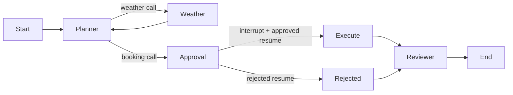

# LangGraph weather and approval graphs

## Five-line concept map

1. **StateGraph** defines nodes and edges; `compile()` creates the runnable graph.
2. **MessagesState** accumulates chat messages through the built-in message reducer.
3. **ToolNode** dispatches typed LangChain tools and returns correlated ToolMessages.
4. **Conditional edges** choose tools, approval, execution/rejection, and termination.
5. **Checkpointer / interrupt / Command** save pending work and resume the same thread.

## Run: beginner -> advanced

Run these commands inside `langgraph/`. This is an independent Python 3.11+ uv project.

```sh
uv sync
uv run main.py "What is the weather in Beijing?"
uv run python -m advanced.run --hitl auto_approve --stream
uv run python -m advanced.run --hitl auto_reject --state-dir .local-data/rejected
uv run python -m advanced.run --hitl scripted \
  --script ../shared/scripts/approve_after_reject.json --state-dir .local-data/scripted
uv run python -m advanced.run --hitl scripted \
  --script ../shared/scripts/timeout.json --state-dir .local-data/timeout
uv run python -m advanced.run --phase prepare --state-dir .local-data/persisted
uv run python -m advanced.run --phase resume --state-dir .local-data/persisted
uv run pytest
```

The beginner model must call `get_weather` before its final natural-language answer.
It loads provider settings through `shared.providers`: environment/root `.env`
first, then literal DeepSeek settings in `~/.zshrc` when no key is configured.
No OpenAI key or manual export is required for those existing DeepSeek assignments.
No shell configuration is executed and no credential values are logged.

Advanced defaults to a deterministic chat-provider double, while the actual graph,
tool dispatch, interrupt, routing, and SQLite checkpointer execute. No key, network,
keyboard prompt, or `input()` is needed. Use a fresh state directory for each run;
a completed directory returns its saved outcome without a new booking effect.

`HITL_MODE=auto_approve|auto_reject|scripted` defaults to `auto_approve`; `--hitl`
overrides it. `HITL_SCRIPT` is the fallback script path. Script exhaustion or timeout
rejects immediately. Scripted all-mode explicitly starts a new attempt after a
rejection when a matching next step exists. `--role readonly` denies bookings.

For paid model calls using the configured provider:

```sh
RUN_LIVE=1 uv run pytest tests/test_advanced.py::test_live_smoke -q
RUN_LIVE=1 uv run python -m advanced.run --live --state-dir .local-data/live
```

Only the opt-in live path spends tokens. It performs several model requests;
allow roughly 10–120 seconds depending on provider latency. Booking is always mock.
DeepSeek thinking is disabled to support required/named tool choice. The beginner
and advanced live smoke have both been verified with the configured DeepSeek model.

## Module map and reading order

| File / symbol | Responsibility |
| --- | --- |
| `main.py:build_graph` | Short model -> ToolNode -> model loop with conditional termination |
| `advanced/run.py` | Entry into the shared unattended lifecycle |
| `advanced/models.py:ScriptChatModel / chat_model` | Mock/live provider selection; never graph-state credentials |
| `advanced/hitl_graph.py:build_graph` | Planner/reviewer roles, tool nodes, and approve/reject routes |
| `advanced/hitl_graph.py:approval` (nested) | Register actual arguments and invoke native `interrupt` |
| `advanced/hitl_graph.py:drive` | SQLite checkpointer, same-thread `Command(resume=...)`, event stream |
| `../shared/cli.py:execute` | Persist simulator decisions and orchestrate prepare/resume |
| `../shared/runtime.py:ToolRuntime` | Allowlist, approval authority, and local mock receipt deduplication |
| `tests/test_advanced.py` | Pre-effect approval, scripts, process restart, native state and policy bypass tests |
| `tests/test_beginner.py` | Actual beginner graph/tool dispatch with a fake provider |

Read `main.py`, then `build_graph` -> nested `approval` -> `drive`.
The advanced route is planner -> weather -> planner -> approval; approval branches
to execution or rejection, and both paths reach a separate reviewer model role.
The graph has explicit END edges and a finite recursion limit.



## Interrupts, history, and effect checkpoints

- `graph.sqlite` is the native LangGraph checkpoint database. Its state includes
  messages and pending graph tasks; the thread ID identifies a conversation/run attempt.
- `checkpoint.json` stores the thread pointer; `session.json` is a separate readable
  conversation export, not independent evidence that a tool side effect committed.
- `approvals.sqlite` is the shared authoritative approval/effect ledger, separate
  from graph persistence. Its tables bind decisions and receipts to `operation_id`.

`interrupt()` suspends at approval without executing booking. Resume reconstructs
the graph with the same SQLite file/thread ID and passes `Command(resume=...)`.
**The interrupted node restarts from its beginning.** Registration before interrupt
is idempotent; booking is a downstream node. Do not move side effects above interrupt
or catch its control-flow exception with a broad exception handler.

The resume value is checked against the persisted decision, and the booking tool
checks the ledger again. A forged `approved=true` value cannot authorize itself.
Native checkpoints and session history do not guarantee exactly-once external
effects: the local mock receipt is transactional, while real APIs still need
downstream idempotency/reconciliation. State files are trusted local harness storage;
one controller owns a state directory.

## Compared with a handwritten Go harness

- You still design the state machine and conditional routes; LangGraph executes them.
- State reducers and checkpointers replace manual message accumulation/snapshot plumbing.
- `interrupt`/`Command` supply a durable pause protocol; approver identity/policy remain app-owned.
- Explicit nodes make approval/execution order visible; node replay requires careful side-effect placement.
- Tool decorators are not a VM sandbox. Execution isolation belongs to the harness/compute layer; MCP is omitted.

## Streaming, tracing, and versions

`--stream` prints native `graph.stream(..., stream_mode="updates")` node updates,
including `__interrupt__`, execution/rejection, and reviewer events. It does not
fabricate token deltas. Structured boundary logs work offline; `LAB_TRACE=1` adds
diagnostics. `FRAMEWORK_TRACE=1` opts into LangSmith via `LANGSMITH_TRACING=true`;
provide its own tracing credentials if exporting, and account for trace data leaving
the process. No default `OTEL_SDK_DISABLED` is set.

Installed versions (`uv pip freeze`):

```text
langgraph==1.2.17
langgraph-checkpoint==4.3.0
langgraph-checkpoint-sqlite==3.1.2
langchain-core==1.7.0
langchain-openai==1.7.2
openai==3.37.0
pytest==9.1.1
```

Initial install: `uv add langgraph langchain-openai langgraph-checkpoint-sqlite python-dotenv`
and `uv add --dev pytest`. The explicit StateGraph API follows the official
[quickstart](https://docs.langchain.com/oss/python/langgraph/quickstart) and
[interrupt guide](https://docs.langchain.com/oss/python/langgraph/interrupts).
This version supports the synchronous SQLite saver and native update stream used here;
the latest guide also documents the newer `stream_events(version="v3")` interface.
